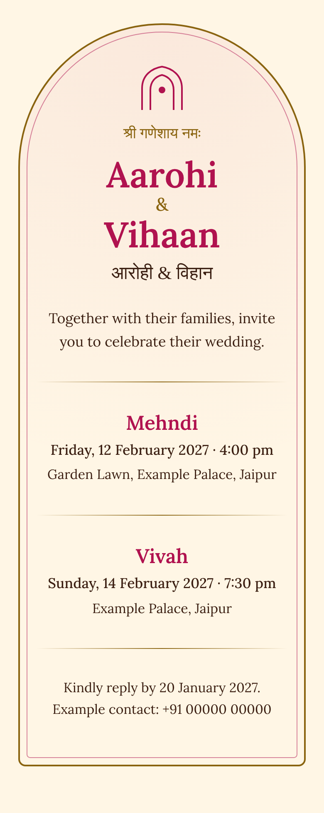
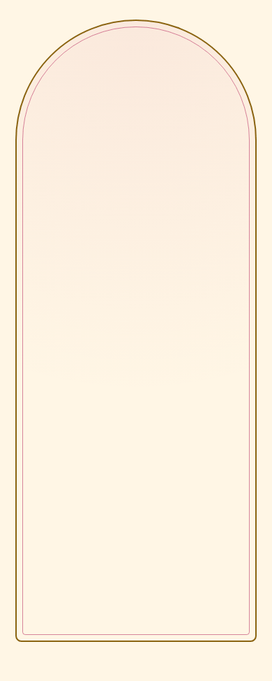
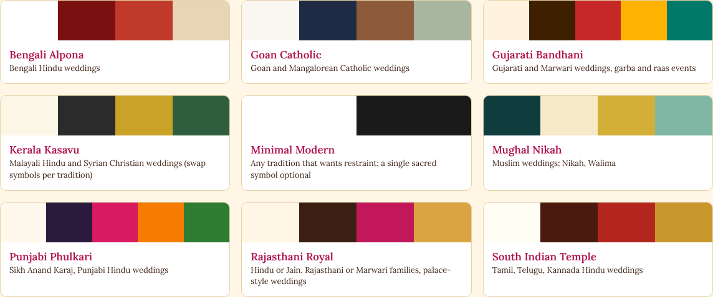
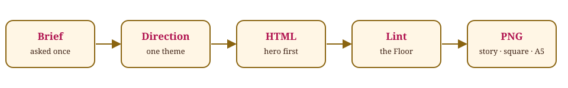

# Indian Wedding Invitation Agent

**An agent skill for Claude Code, Codex, Cursor and OpenCode that designs Indian wedding invitations people would actually send.**

One self-contained HTML page, rendered to PNG for WhatsApp, print or social. Built from the tradition the couple names, in the scripts the families read.

<p align="center">
  
  &nbsp;&nbsp;&nbsp;
  
</p>

<p align="center"><sub>Example card for a fictional couple. Right: the card assembling section by section, names and date first. This is an illustration of the hero-first approach, not a recording of an agent run. Screenshots use a stand-in serif for headings; the live card loads Cormorant Garamond and Tiro Devanagari Hindi.</sub></p>

## What it does

- Asks once for the facts it needs: tradition, region, names, events, languages, output size.
- Never invents names, dates, venues, muhurat or scripture.
- Designs from nine regional and community themes, or a custom direction, as original compositions.
- Typesets Devanagari, Gurmukhi, Bengali, Tamil, Telugu, Kannada, Malayalam, Gujarati and Urdu with real fonts and correct `lang`.
- Lints the result against a hard floor, then exports PNG at story, square, portrait or A5 sizes.

## Quick start

```
git clone https://github.com/<you>/indian-wedding-invitation-agent
cd indian-wedding-invitation-agent
node skills/wedding-invitation/scripts/install.mjs
```

Then, in Claude Code:

```
/invite hindu, Rajasthani, Aarohi and Vihaan, Hindi + English
```

Or edit `templates/brief.example.json` and pass the path.

PNG export needs Node 18+, `npm i -g puppeteer-core`, and Chrome. Without them you still get the HTML.

## Commands

| Command | What it does |
|---|---|
| `/invite` | Brief, design, lint and export an invitation |
| `/audit` | Report on an existing invitation, no edits |
| `/export` | Render HTML to PNG |
| `/add-theme` | Add a regional or community theme |

## Themes



Rajasthani Royal · South Indian Temple · Bengali Alpona · Punjabi Phulkari · Gujarati Bandhani · Kerala Kasavu · Mughal Nikah · Goan Catholic · Minimal Modern · or custom.

A theme is a material (palette, motif family, type), never a plan. See [`skills/wedding-invitation/references/themes/`](skills/wedding-invitation/references/themes).

## How a build runs



1. Intake: one message, a validated `brief.json`.
2. Direction: one tradition note, one theme.
3. Copy in the requested languages, family wording first.
4. Hero first (names and date), reviewed, then the rest.
5. `lint-invite.mjs` for the Floor, then a cold read at 390px.
6. Export PNG if wanted.

## The gates

- **Floor** never ships: invented facts, leftover placeholders, broken scripts, contrast under 4.5:1, horizontal scroll, remote assets, mixed sacred symbols without request, unsupplied scripture.
- **Reflex** are model defaults to overrule only on the record: gold gradient everywhere, one mandala behind everything, script font for all text.
- **Finish** is craft detail that never blocks.

## Design principles

Every design is original. The agent takes inspiration from art forms and traditions, never from a specific template, brand or artist's layout, and it does not trace or closely imitate existing designs.

## Repository layout

```
.claude-plugin/        plugin manifest and marketplace
.claude/commands/      /invite /audit /export /add-theme
skills/wedding-invitation/
  SKILL.md             the workflow and the Floor
  references/          intake, traditions, copy, typography, gates, themes/
  scripts/             validate-brief, lint-invite, render-png, install
templates/             invite-base.html, brief.example.json
examples/              a finished example card (fictional couple)
eval/                  prompts and a scoring rubric
tests/                 node:test suite
docs/                  architecture, privacy, readme-assets/ (regenerates the images)
assets/readme/         README images and GIF
```

## Privacy

Real briefs contain names, addresses and dates. `briefs/*.json` and `output/` are gitignored. Do not commit them. See [docs/privacy.md](docs/privacy.md).

## Contributing

See [CONTRIBUTING.md](CONTRIBUTING.md). Themes from within a tradition are especially welcome, with a note on who reviewed them.

## Licence

MIT.
